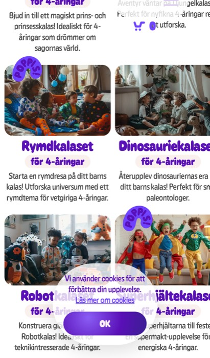
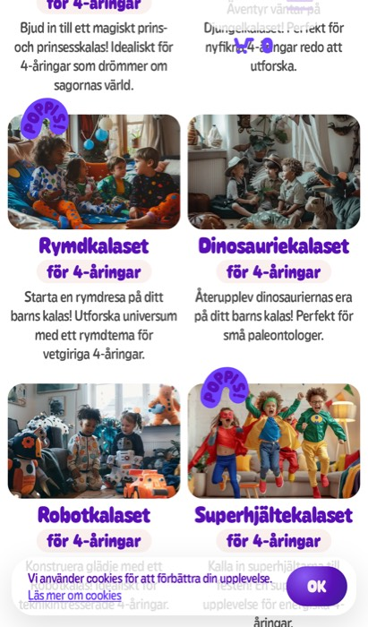
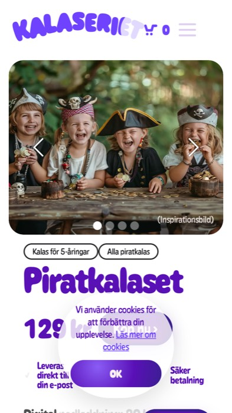
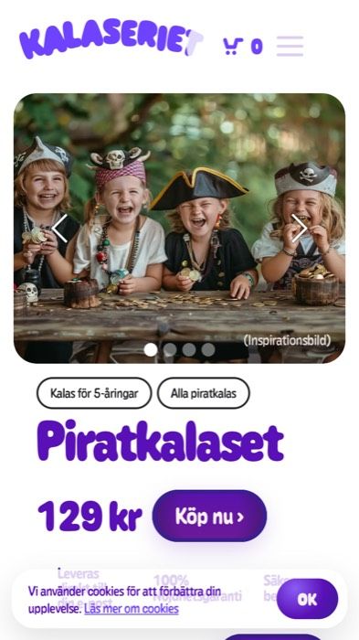
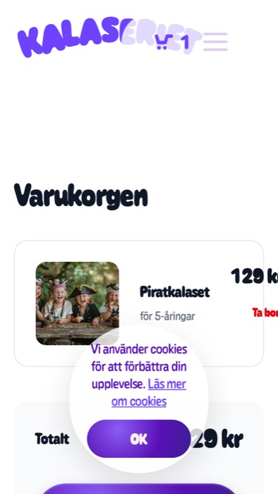
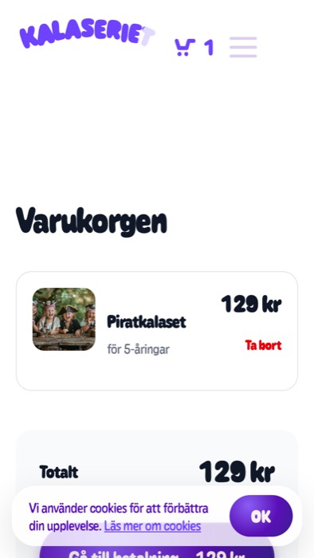
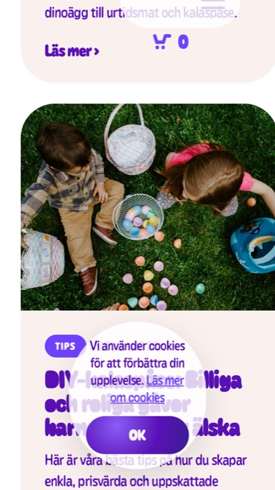
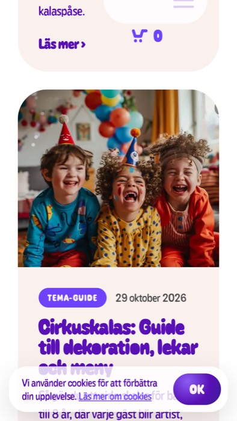
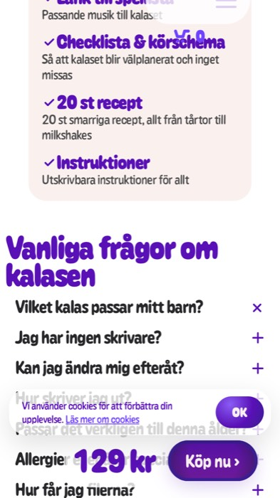

# Mobile audit of live kalaseriet.se, 2026-11-20

Joel: "känns buggig på mobil". Checked live in Safari's engine (Playwright WebKit) at iPhone 13 (390 px),
iPhone SE 3rd gen (375 px) and iPhone SE 1st gen (320 px), plus Chrome for layout-shift sources.
Pages: home, /kalas, an age page, a product page, a theme page, /kalasbloggen, a blog post, /faq, /kontakt,
/varukorg, /tack, the menu, and the buy path (Köp nu and /varukorg both reach Stripe; nothing was paid).
Rerun: `CHECKOUT=1 node scripts/mobile-audit.mjs https://kalaseriet.se <outdir>` (or a local build).

Open PRs #21-#25 were checked against a local build of work/print-all: none of the problems below was fixed there.
All fixed on work/mobile-fixes (stacked on #25). Screenshots: before = live, after = the branch.

| # | Problem (live) | Where | Fix |
|---|---|---|---|
| 1 | Product grid's right column ran ~20 px past the screen edge: names and pictures cut off ("Dinosauriekalase", "Superhjältekalase") | Home, /kalas, age pages, "fler kalas" on product pages; every phone width | Grid items may shrink (`min-width: 0`); listing name scales with the screen (`min(1.7rem, 6.6vw - 2px)`); checked 320-900 px: no overflow, no word broken |
| 2 | Cookie banner wrapped into a big circle mid-screen, covering the price, Köp nu and the checkout button until OK was tapped | Every page, first visit | On phones a low bar along the bottom; above the sticky buy bar when that shows. Desktop unchanged |
| 3 | Logo ran under the cart icon | Header, below ~390 px | Logo width `min(14.1rem, 100vw - 170px)` on phones |
| 4 | Newsletter field (footer, every page) and contact/feedback fields are 14 px: iOS Safari zooms the page in on tap and stays zoomed | Every page | Fields 16 px on phones (no screenshot: only a real iPhone zooms) |
| 5 | Home page jumped while scrolling (CLS 0.096): the checklist picture and the soundwave animation had no size until loaded | Home, bento | Picture gets width/height, animation placeholder a 2:1 box: CLS 0 |
| 6 | Cart row: price and "Ta bort" cut off | /varukorg at 320 px | Smaller picture, padding and gap below 640 px |
| 7 | Blog cards 300 px wide in a 272 px column: cut off | /kalasbloggen at 320 px (same pattern fixed in testimonials, blog post, /spellistor) | `minmax(min(300px, 100%), 1fr)` |
| 8 | Small tap targets: footer links 24 px tall and stacked, theme/age tags 27 px | Footer, product/theme/age pages | Footer links 36 px, tags ~36 px on phones |

Not changed (fine or not ours): Stripe checkout page; menu opens and closes; no JS errors; Caraque font loads on
every page; inline text links (e.g. "villkoren") are below 32 px but sit in running text; contact radio buttons are
12 px but their labels are tappable. Download (/tack with a paid session) cannot be tested on live without paying;
/tack without a session renders correctly.

 
 
 
 
 

